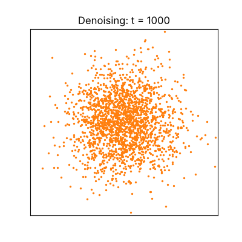

# Diffusion Experiments

**Small, readable diffusion models in plain PyTorch, from 2D points to handwritten digits.**

[](LICENSE)


<p align="center">
  
  &nbsp;&nbsp;
  
</p>

## Overview

This repository is a hands-on introduction to diffusion models. It contains two self-contained projects that implement the
same idea at two scales, using nothing but PyTorch (no `diffusers` or other diffusion library):

1. a diffusion model over **2D points**, small enough that every stage can be plotted and inspected;
2. a **class-conditional diffusion model over MNIST digits**, with fast sampling and classifier-free guidance.

Both projects are built around the same principles:

- **One script per stage.** The pipeline is split into five numbered scripts. Each one produces a figure, so you can run a
  single stage and see what it does before moving on.
- **Small, commented code.** The library code of each project is a handful of short modules meant to be read, not just run.
- **Runs on a laptop.** Everything works on a CPU. The MNIST project additionally uses a GPU automatically, if there is one,
  to train larger models.
- **Results included.** The output of a full run is committed, so you can look at the figures before running anything.

## Projects

| | [`diffusion_2d`](diffusion_2d) | [`diffusion_mnist`](diffusion_mnist) |
|---|---|---|
| **Data** | 2D points (two moons, swiss roll) | MNIST handwritten digits, 28x28 |
| **Network** | MLP, about 38k parameters | U-Net, 100k parameters by default, configurable up to millions, optional attention |
| **Conditioning** | none | digit label, randomly dropped during training |
| **Techniques** | DDPM sampling, DDIM sampling, learned vector field | DDPM and DDIM sampling, classifier-free guidance, EMA weights, mixed precision |
| **Time to run** | under a minute on CPU | about 14 minutes on CPU (default model); 35 minutes on a free Kaggle GPU (1.5M-parameter model) |
| **Start here if** | diffusion models are new to you | you know the 2D version and want to see it on images |

The recommended order is `diffusion_2d` first: the MNIST project reuses the same ideas and only explains what is new.

## Repository structure

```
diffusion_experiments/
├── LICENSE                  MIT license
├── README.md                this file
├── .gitignore
│
├── diffusion_2d/            Project 1: diffusion on 2D points
│   ├── README.md            full guide to this project
│   ├── requirements.txt
│   ├── run_all.py           runs the five steps in order
│   ├── step1_forward_process.py     ... step5_vector_field.py
│   ├── tinydiff/            the library: datasets, noise schedule, MLP, samplers, metric
│   └── results/             figures and trained models of the reference run
│
└── diffusion_mnist/         Project 2: class-conditional diffusion on MNIST
    ├── README.md            full guide to this project
    ├── requirements.txt
    ├── run_all.py           runs the five steps in order
    ├── step1_forward_process.py     ... step5_guidance.py
    ├── generate.py          generate the digit you ask for with a trained model
    ├── colab_kaggle.ipynb   notebook to train on a free Kaggle or Colab GPU
    ├── tinymnist/           the library: data, schedule, U-Net, samplers, classifier
    ├── results/             output of the default run (100k parameters, CPU)
    └── results_gpu/         output of the larger run (1.5M parameters, Kaggle GPU)
```

Each project folder is independent: it has its own `requirements.txt`, its own `run_all.py` and its own README, which is
the place to go for the details of a project (what every script produces, options, results, troubleshooting).

## Getting started

```bash
git clone https://github.com/carlos-vi/diffusion_experiments.git
cd diffusion_experiments/diffusion_2d            # or diffusion_mnist
python -m venv .venv
source .venv/bin/activate                        # on Windows: .venv\Scripts\activate
pip install -r requirements.txt
python run_all.py
```

Run the scripts from inside the project folder, because they read and write `results/` relative to the current directory.
The figures appear in `results/`. The first run of `diffusion_mnist` downloads MNIST (about 11 MB), so it needs Internet access.

## How diffusion works, in short

Both projects implement the same four ideas:

1. **Forward process.** Noise is added to a data point little by little until only Gaussian noise is left. Nothing is
   learned here, and there is a closed form to jump straight to any step `t`:
   `x_t = sqrt(alpha_bar_t) * x_0 + sqrt(1 - alpha_bar_t) * eps`.
2. **Training.** Take a clean sample, noise it to a random step `t`, and train a network to predict the noise `eps` that was
   added. The loss is a plain mean squared error.
3. **Reverse process.** Start from pure noise and apply the network `T` times, each time removing a bit of the predicted noise.
   The result is a new sample. This is the DDPM sampler.
4. **Faster sampling.** DDIM reuses the same trained network but needs far fewer steps (tens instead of a thousand).

The MNIST project adds a fifth idea, **classifier-free guidance**: the model is trained both with and without the label,
and at sampling time the two predictions are combined as `eps = eps_uncond + w * (eps_cond - eps_uncond)`, where `w`
controls how strongly the label is followed.

## Results at a glance

**2D points** (two moons). Error is the mean distance from each generated point to its nearest real point; lower is better.

| Sampler | Network calls | Error |
|---|---|---|
| DDIM | 5 | 0.13 |
| DDIM | 20 | 0.04 |
| DDPM | 1000 | 0.032 |

Twenty DDIM steps get close to the 1000-step DDPM result.

**MNIST.** Share of generated digits that an independent classifier assigns to the requested digit (60 images per setting;
`w` is the guidance strength, and `w = 0` ignores the label, so about 10% is chance):

| Guidance `w` | 100k model, CPU, 5000 steps | 1.5M model, Kaggle GPU, 20000 steps |
|---|---|---|
| 0 | 12% | 8% |
| 1 | 77% | 98% |
| 3 | 100% | 100% |
| 6 | 100% | 100% |

The larger model took 35 minutes to train on a free Kaggle GPU. The full tables, timings and figures are in the project READMEs.

## Reproducibility and requirements

- **Software.** Python 3 and PyTorch (`diffusion_mnist` needs 2.3 or newer), plus `numpy`, `matplotlib` and `pillow`
  (`torchvision` too for MNIST). The results were produced with Python 3.11.9, torch 2.14.1 (CPU build), torchvision 0.29.1,
  numpy 2.4.6, matplotlib 3.11.2 and pillow 13.0.0. Other recent versions should work but have not been tried.
- **Hardware.** No GPU is needed. About 1 GB of free RAM is enough, and most of it is `import torch` itself.
- **Determinism.** Every script fixes its random seeds, so running the same command twice on the same machine gives the same
  result. Other PyTorch versions, CPUs or GPUs can change the numbers slightly, and GPU training (especially with mixed
  precision) is not bit-for-bit deterministic. The sampling noise is always drawn on the CPU and then moved to the device, so a
  given seed starts from the same noise everywhere.
- **Commands used.** The command that produced each committed `results/` folder is written in that project's README.

## References

- Ho, Jain, Abbeel. *Denoising Diffusion Probabilistic Models* (DDPM), 2020. <https://arxiv.org/abs/2006.11239>
- Song, Meng, Ermon. *Denoising Diffusion Implicit Models* (DDIM), 2021. <https://arxiv.org/abs/2010.02502>
- Ho, Salimans. *Classifier-Free Diffusion Guidance*, 2022. <https://arxiv.org/abs/2207.12598>

## License

The code is released under the [MIT License](LICENSE).

The MNIST dataset is not part of this repository. `torchvision` downloads it from its original source the first time you
run `diffusion_mnist`, and it belongs to its authors (Y. LeCun, C. Cortes and C. Burges) under its own terms.
