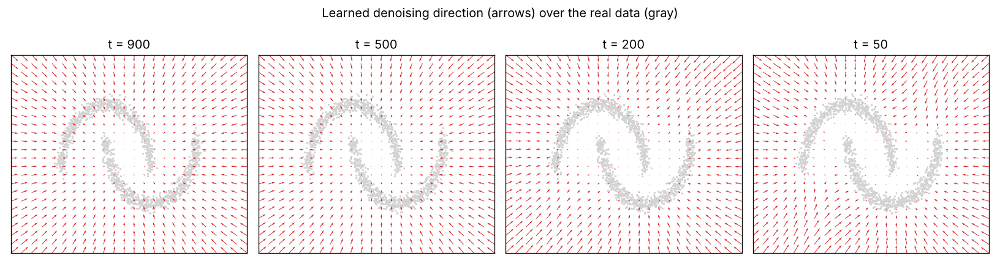

# Diffusion on 2D points

**A diffusion model small enough to run on any laptop, built to understand how the idea works.**

Instead of images it generates **2D points** (two moons, or a swiss roll), so every stage of the process can be plotted
and looked at. The network has about 38k parameters and the whole pipeline runs in under a minute on a CPU.

<p align="center">
  
  &nbsp;&nbsp;
  
</p>

## Contents

- [Quick start](#quick-start)
- [The idea in five steps](#the-idea-in-five-steps)
- [Pipeline: what each script does](#pipeline-what-each-script-does)
- [Results of the reference run](#results-of-the-reference-run)
- [Experiments to try](#experiments-to-try)
- [Project structure](#project-structure)
- [Reproducibility and requirements](#reproducibility-and-requirements)
- [Troubleshooting](#troubleshooting)
- [References and license](#references-and-license)

## Quick start

```bash
git clone https://github.com/carlos-vi/diffusion_experiments.git
cd diffusion_experiments/diffusion_2d
python -m venv .venv
source .venv/bin/activate          # on Windows: .venv\Scripts\activate
pip install -r requirements.txt
python run_all.py                  # two moons; use `python run_all.py swiss` for the swiss roll
```

Everything is written to `results/`. The repository already contains the results of a run, so you can look at them before
running anything. Run the scripts from inside this folder, because they use `tinydiff/` and `results/` relative to it.

## The idea in five steps

1. **Forward process.** Repeatedly add a little Gaussian noise to a data point until only noise is left.
   This needs no learning, and there is a closed form to jump straight to any step `t`.
2. **Training.** Take a clean point, noise it to a random step `t`, and train a network to predict *which noise* was added
   (a simple MSE loss).
3. **Reverse process.** Start from pure noise and apply the network `T` times, each time removing a bit of the predicted
   noise. Out comes a new data point.
4. **Faster sampling.** DDIM reuses the same trained network but takes far fewer steps.
5. **What was learned.** The predicted noise points away from the data, so minus the predicted noise is an arrow towards the
   data (this is the "score").

## Pipeline: what each script does

Every script writes its figures to `results/` and can be run on its own (for example `python step2_train.py --dataset swiss`).
Steps 3 to 5 need the model trained in step 2.

| Script | Output in `results/` | What to look for |
|---|---|---|
| `step1_forward_process.py` | `1_forward_process_*.png`, `1_noise_schedule.png` | The shape fades into a Gaussian blob. `alpha_bar` goes from 1 to about 0. |
| `step2_train.py` | `2_training_loss_*.png`, `model_*.pt` | The loss drops quickly, then plateaus. It never reaches 0, because the noise is random and cannot be predicted exactly. |
| `step3_sample.py` | `3_real_vs_generated_*.png`, `3_reverse_process_*.gif` | The GIF is the reverse process: noise condenses into the moons. |
| `step4_ddim_vs_ddpm.py` | `4_ddim_vs_ddpm_*.png` | Quality as a function of the number of steps (see the results below). |
| `step5_vector_field.py` | `5_vector_field_*.png` | At high `t` the arrows point to the overall blob; at low `t` they snap to the thin curves. |

`run_all.py` runs the five scripts in order. `step2_train.py` takes `--dataset` (`moons` or `swiss`), `--steps` (default 8000),
`--batch` (default 512), `--lr` and `--out`.

## Results of the reference run

Two moons. Error is the mean distance from each generated point to its nearest real point (lower is better):

| Sampler | Network calls | Error |
|---|---|---|
| DDIM | 2 | 2.80 |
| DDIM | 5 | 0.13 |
| DDIM | 20 | 0.04 |
| DDIM | 100 | 0.034 |
| DDPM | 1000 | 0.032 |

Twenty DDIM steps get close to the 1000-step DDPM result. With 2 steps the result is garbage: the first jump leaves the points
far from anything the network saw during training, and there is no second chance to correct it. Exact numbers vary slightly
with the PyTorch version.

## Experiments to try

- Change `beta_end` or `T` in `tinydiff/schedule.py` and see how step 1 and the samples change.
- Shrink the network (`hidden` in `tinydiff/model.py`) or train for fewer steps (`--steps 500`) and watch the samples degrade.
- Add your own dataset to `tinydiff/data.py`.

## Project structure

```
diffusion_2d/
├── tinydiff/                     The library, imported by the scripts
│   ├── data.py                   Toy datasets (two moons, swiss roll), normalised to zero mean and unit variance
│   ├── schedule.py               Noise schedule and the forward process q(x_t | x_0)
│   ├── model.py                  Time-conditioned MLP that predicts the noise
│   ├── sampling.py               DDPM and DDIM samplers
│   └── metrics.py                Nearest-neighbour error used to score generated points
├── step1_forward_process.py      Forward process and noise schedule figures
├── step2_train.py                Trains the network and saves the model
├── step3_sample.py               Reverse process, with an animation
├── step4_ddim_vs_ddpm.py         Sampling quality against number of steps
├── step5_vector_field.py         The direction the model pushes points at each noise level
├── run_all.py                    Runs the five steps in order
├── requirements.txt
└── results/                      Figures and trained models of the reference run
```

## Reproducibility and requirements

- Tested with Python 3.11.9, torch 2.14.1 (CPU build), numpy 2.4.6, matplotlib 3.11.2 and pillow 13.0.0.
  `requirements.txt` asks for `torch>=2.0`. Other versions should work but have not been tried.
- No GPU is needed. Measured peak memory with the default (CUDA) PyTorch wheel was about 700 to 850 MB per step, and roughly
  500 MB of that is just `import torch`. The model and data use a few MB.
- Seeds are fixed, so a second run on the same machine gives the same files. Other PyTorch versions or CPUs can change the
  numbers slightly.
- The default `torch` wheel can be large. The CPU-only build is lighter:

  ```bash
  pip install torch --index-url https://download.pytorch.org/whl/cpu
  pip install numpy matplotlib pillow
  ```

## Troubleshooting

| Problem | Fix |
|---|---|
| `ModuleNotFoundError: No module named 'tinydiff'` | Run the scripts from inside `diffusion_2d`, not from the repository root. |
| `FileNotFoundError: results/model_moons.pt` when running step 3, 4 or 5 on its own | Run step 2 first for that dataset (`python step2_train.py --dataset moons`). |
| `source: command not found` on Windows | Use `.venv\Scripts\activate` (PowerShell: `.venv\Scripts\Activate.ps1`). |
| Out of memory | Use the CPU-only PyTorch build shown above. |

## References and license

The method comes from Ho et al., [*Denoising Diffusion Probabilistic Models*](https://arxiv.org/abs/2006.11239) (2020), and
Song et al., [*Denoising Diffusion Implicit Models*](https://arxiv.org/abs/2010.02502) (2021).

Released under the MIT license, see [`../LICENSE`](../LICENSE). The next project is [`../diffusion_mnist`](../diffusion_mnist).
