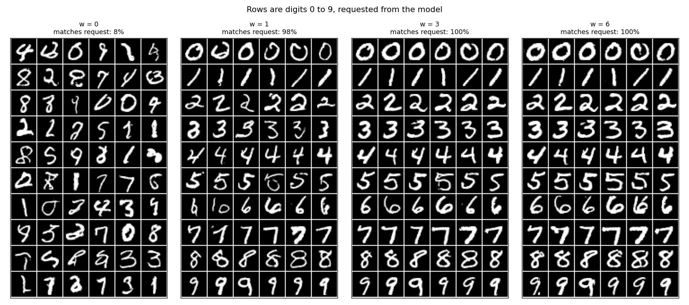

# Class-conditional diffusion on MNIST

**A small diffusion model that draws the handwritten digit you ask for, with fast sampling and classifier-free guidance.**

This is the image version of [`../diffusion_2d`](../diffusion_2d), so read that one first if diffusion models are new to
you. By default the network is a U-Net with about 100k parameters and everything runs on a laptop CPU. The width can be
increased and a GPU is used automatically when there is one, which is how the larger model in [`results_gpu/`](results_gpu)
was trained, on a free Kaggle GPU.

<p align="center">
  
</p>

<p align="center"><em>Rows are the requested digits 0 to 9. Columns of panels are increasing guidance strength w (1.5M-parameter model).</em></p>

## Contents

- [Quick start](#quick-start)
- [What is different from the 2D version](#what-is-different-from-the-2d-version)
- [Pipeline: what each script does](#pipeline-what-each-script-does)
- [Results](#results)
- [Training options](#training-options)
- [Train on a free GPU](#train-on-a-free-gpu)
- [Generate a digit of your choice](#generate-a-digit-of-your-choice)
- [Experiments to try](#experiments-to-try)
- [Project structure](#project-structure)
- [Reproducibility and requirements](#reproducibility-and-requirements)
- [Troubleshooting](#troubleshooting)
- [References and license](#references-and-license)

## Quick start

```bash
git clone https://github.com/carlos-vi/diffusion_experiments.git
cd diffusion_experiments/diffusion_mnist
python -m venv .venv
source .venv/bin/activate          # on Windows: .venv\Scripts\activate
pip install -r requirements.txt
python run_all.py --quick          # a few minutes: checks that everything works (the digits will look bad)
python run_all.py                  # the full run: 5000 training steps
```

MNIST (about 11 MB) is downloaded to `data/` on the first run, so the first run needs Internet access. Run the scripts from
inside this folder. Everything is written to `results/`, which already contains the output of a full run made with the
default options.

On a 4-core CPU the 5000-step training took about 11 minutes and the whole pipeline about 14 minutes. A weaker machine will be
slower; lower `--steps` if needed.

## What is different from the 2D version

- **A U-Net instead of an MLP.** The network uses convolutions, down- and up-sampling and skip connections.
- **It is told which digit to draw.** The label is randomly dropped during training (10% of the time), so the same network can
  also draw without a label. This is what makes classifier-free guidance (step 5) possible.
- **EMA weights.** An exponential moving average of the weights is what gets saved and used for sampling. It gives cleaner
  samples than the raw weights.
- **It can scale.** The width of the U-Net, an optional attention layer and mixed precision are configurable, so the same code
  trains a 100k-parameter model on a CPU or a 1.5M-parameter model on a GPU.

## Pipeline: what each script does

Every script writes its output to `results/` (or to the folder given with `--out`) and can be run on its own. Steps 3 to 5
need the model trained in step 2.

| Script | Output in `results/` | What to look for |
|---|---|---|
| `step1_forward_process.py` | `1_forward_process.png`, `1_noise_schedule.png` | Real digits turning into static. By t = 400 the digit is barely visible. |
| `step2_train.py` | `2_training_loss.png`, `model.pt`, `model_config.json` | The loss drops quickly and then plateaus. |
| `step3_sample.py` | `3_generated_digits.png`, `3_reverse_process.png`, `3_reverse_process.gif` | 64 digits generated without any label, and the denoising animation. |
| `step4_fast_sampling.py` | `4_fast_sampling.png` | The same starting noise denoised in 3, 5, 10, 25, 50 and 1000 steps. |
| `step5_guidance.py` | `5_guidance.png`, `classifier.pt` | Rows are the requested digits 0 to 9, for increasing guidance strength. |

`run_all.py` runs the five scripts in order and passes any option you give it on to `step2_train.py`, for example
`python run_all.py --steps 20000 --base 64`. The flag `--quick` is a shortcut for `--steps 300`.

## Results

### Default run (100k parameters, CPU)

**Fast sampling** (12 images, 4-core CPU). DDIM reuses the same network with far fewer steps:

| Sampler | Network calls | Time |
|---|---|---|
| DDIM | 3 | under 0.1 s (images are blurry) |
| DDIM | 5 to 10 | about 0.1 s (recognisable) |
| DDIM | 50 | 0.5 s |
| DDPM | 1000 | about 10 s |

**Classifier-free guidance.** The model combines its label-free and labelled predictions as
`eps = eps_uncond + w * (eps_cond - eps_uncond)`. A separate small classifier (98% test accuracy, trained once in about
20 seconds) checks whether each generated digit is the one that was asked for (60 images per setting, DDIM with 50 steps):

| Guidance w | Matches the request |
|---|---|
| 0 (label ignored) | 12% (chance is 10%) |
| 1 (follow the label) | 77% |
| 3 | 100% |
| 6 | 100% |

Higher guidance gives cleaner, more typical digits and less variety: look at how similar the rows in the `w = 6` panel are
to each other. The model is small and trained briefly, so the free-form digits (step 3) are often wobbly or ambiguous.

### Larger run (1.5M parameters, Kaggle GPU)

The same pipeline, run with `python run_all.py --steps 20000 --base 64 --attn --batch 256 --amp`. The output is in
[`results_gpu/`](results_gpu).

| | Default run (CPU) | Larger run (Kaggle GPU) |
|---|---|---|
| Parameters | 103k | 1.5M |
| Training | 5000 steps, batch 128, 11 min | 20000 steps, batch 256, 2093 s (35 min) |
| Training images seen | 0.64M | 5.1M |
| DDPM, 1000 steps, 12 images | about 10 s (CPU) | 3.8 s (GPU) |
| DDIM, 50 steps, 12 images | 0.5 s (CPU) | 0.2 s (GPU) |

| Guidance w | Matches the request |
|---|---|
| 0 (label ignored) | 8% (chance is 10%) |
| 1 (follow the label) | 98% |
| 3 | 100% |
| 6 | 100% |

The label-free digits of step 3 are much cleaner than in the default run, though a few are still ambiguous. With `w = 0` the
model ignores the label, so matching about 10% of the time is just chance: that panel is the control of the experiment.

## Training options

Options of `step2_train.py` (also accepted by `run_all.py`):

| Option | Default | Effect |
|---|---|---|
| `--steps N` | 5000 | Number of training steps, each one a weight update on a batch. |
| `--batch N` | 128 | Batch size. A GPU handles 256 or 512 easily. |
| `--lr X` | 2e-3 | Learning rate. The larger run in [`results_gpu/`](results_gpu) used the default. |
| `--base N` | 16 | U-Net width, a multiple of 8. 16 is 100k parameters, 32 is 370k, 64 is 1.4M, 96 is 3.3M (with `--attn`). |
| `--attn` | off | Adds self-attention in the 7x7 bottleneck. |
| `--amp` | off | Mixed precision (fp16): faster and uses less VRAM. Ignored on CPU. |
| `--out DIR` | `results` | Folder for the model and figures. |

The chosen architecture is saved in `model_config.json` next to `model.pt`, so steps 3 to 5 rebuild the same network. A
`model.pt` without that file is read as the default small network.

## Train on a free GPU

The code uses the GPU automatically when PyTorch can see one, and the CPU otherwise. The images are only 47 MB, so what limits
a bigger model is GPU memory (VRAM), not RAM. Free options (limits change, check each site):

| Platform | GPU | Notes |
|---|---|---|
| [Kaggle Notebooks](https://www.kaggle.com/code) | P100 16 GB or 2x T4 | About 30 GPU hours per week, long sessions. Needs a verified phone number. |
| [Google Colab](https://colab.research.google.com) | T4 16 GB | Shorter sessions, GPU not guaranteed. Can save to Google Drive. |
| [Lightning AI Studios](https://lightning.ai) | T4 and others | Monthly free credits. |

**With the notebook.** Open [`colab_kaggle.ipynb`](colab_kaggle.ipynb) on one of those platforms (upload it, or open it from
GitHub), turn on a GPU and run the cells from top to bottom. The notebook clones this repository, so the session needs Internet
access (on Kaggle: *Session options, Internet, On*). Re-running its first cell is safe. When it finishes, download `results.zip`
before closing the session, because the disk is wiped when the session ends.

**From a terminal with a GPU:**

```bash
python run_all.py --steps 20000 --base 64 --attn --batch 256 --amp
```

Run a short test first (`--steps 300`) to check that the GPU is used (the training script prints `Device: cuda`) and to see how
long the full run would take.

**Train on a GPU, sample on your CPU.** `model.pt` and `model_config.json` are all that steps 3 to 5 need. Copy them from the
GPU session into a folder and point the scripts at it with `--out`. The repository contains such a folder, with the model trained
on Kaggle:

```bash
python step4_fast_sampling.py --out results_gpu
python step5_guidance.py --out results_gpu
python step3_sample.py --out results_gpu
```

These rewrite the figures in that folder. The larger model is slower per network call on a CPU, so the 1000-step DDPM sampler
of steps 3 and 4 can take a long time there, while the DDIM sampler is much faster. `classifier.pt` is not needed (and is not
committed): step 5 trains it again in about 20 seconds if it is missing.

## Generate a digit of your choice

`generate.py` loads a trained model and draws the digit you ask for. On a CPU it takes a few seconds:

```bash
python generate.py --digit 7 --out results_gpu
```

The image is saved in `samples/` (git-ignored).

| Option | Default | Effect |
|---|---|---|
| `--digit 0-9` | required | The digit to draw. |
| `--n N` | 1 | How many images of that digit, shown as a grid. |
| `--seed N` | 0 | Change it to get a different image of the same digit. |
| `--guidance W` | 3 | 0 ignores the digit, 1 follows it, higher follows it harder (cleaner, less varied). |
| `--steps N` | 50 | DDIM steps. 10 is already recognisable. |
| `--out DIR` | `results` | Folder that holds `model.pt`, for example `results_gpu`. |

## Experiments to try

- Train with `--steps 1000` and `--steps 10000` and compare the digits.
- Change the width of the U-Net with `--base` and add `--attn`.
- Try guidance values between 0 and 3 in `step5_guidance.py`, or with `generate.py --guidance`.
- Generate the same digit with several seeds and see how much the model varies it.

## Project structure

```
diffusion_mnist/
├── tinymnist/                    The library, imported by the scripts
│   ├── data.py                   MNIST loading and conversion to the [-1, 1] range
│   ├── schedule.py               Noise schedule and the forward process q(x_t | x_0)
│   ├── model.py                  Time- and label-conditioned U-Net, optional attention, save and load helpers
│   ├── sampling.py               DDPM and DDIM samplers with classifier-free guidance
│   ├── classifier.py             Small CNN used only to score step 5
│   ├── device.py                 Picks the GPU if there is one, otherwise the CPU
│   └── viz.py                    Image-grid plotting helper
├── step1_forward_process.py      Real digits dissolving into noise
├── step2_train.py                Trains the U-Net and saves model.pt and model_config.json
├── step3_sample.py               Reverse process: noise to digits, with an animation
├── step4_fast_sampling.py        DDIM against DDPM, by number of steps
├── step5_guidance.py             Requesting digits at different guidance strengths
├── run_all.py                    Runs the five steps in order
├── generate.py                   Draws the digit you ask for with a trained model
├── colab_kaggle.ipynb            Notebook to train on a free Kaggle or Colab GPU
├── requirements.txt
├── results/                      Output of the default run (100k parameters, CPU)
├── results_gpu/                  Output of the larger run (1.5M parameters, Kaggle GPU)
├── data/                         MNIST, downloaded on the first run (git-ignored)
└── samples/                      Images made by generate.py (git-ignored)
```

## Reproducibility and requirements

- Tested with Python 3.11.9, torch 2.14.1 (CPU build), torchvision 0.29.1, numpy 2.4.6, matplotlib 3.11.2 and pillow 13.0.0.
  `requirements.txt` asks for `torch>=2.3` (the mixed-precision option needs it) and `torchvision>=0.18`. Other versions should
  work but have not been tried.
- Seeds are fixed, so a second run on the same machine gives the same files. Other PyTorch versions, CPUs or GPUs can change the
  numbers slightly, and GPU training (especially with `--amp`) is not bit-for-bit deterministic. The sampling noise is drawn on
  the CPU and then moved, so a given seed starts from the same noise on CPU and GPU.
- Peak memory per step was 800 to 1000 MB with the default (CUDA) PyTorch wheel, of which about 500 MB is just `import torch`.
  The CPU-only build is lighter:

  ```bash
  pip install torch torchvision --index-url https://download.pytorch.org/whl/cpu
  pip install numpy matplotlib pillow
  ```

- The committed `results/` come from `python run_all.py` and `results_gpu/` from
  `python run_all.py --steps 20000 --base 64 --attn --batch 256 --amp`.

## Troubleshooting

| Problem | Fix |
|---|---|
| `ModuleNotFoundError: No module named 'tinymnist'` | Run the scripts from inside `diffusion_mnist`, not from the repository root. |
| MNIST fails to download | The first run needs Internet access. Check your connection or proxy; the files go to `data/`. |
| `FileNotFoundError: results/model.pt` in step 3, 4 or 5 | Run step 2 first, or pass the folder that holds the model with `--out`. |
| Size mismatch when loading `model.pt` | The model was trained with other `--base` or `--attn` options. Keep `model_config.json` next to `model.pt`. |
| It runs on CPU although I have a GPU | Install a CUDA build of PyTorch from pytorch.org. `python -c "import torch; print(torch.cuda.is_available())"` must print `True`. |
| `CUDA out of memory` | Lower `--batch` or `--base`. |
| Kaggle or Colab cannot clone the repository | Turn on Internet in the session settings. |
| The digits look like blobs | The model is undertrained. A 300-step run (`--quick`) does this; use the default 5000 steps or more. |
| `source: command not found` on Windows | Use `.venv\Scripts\activate` (PowerShell: `.venv\Scripts\Activate.ps1`). |

## References and license

- Ho, Jain, Abbeel. [*Denoising Diffusion Probabilistic Models*](https://arxiv.org/abs/2006.11239) (DDPM), 2020.
- Song, Meng, Ermon. [*Denoising Diffusion Implicit Models*](https://arxiv.org/abs/2010.02502) (DDIM), 2021.
- Ho, Salimans. [*Classifier-Free Diffusion Guidance*](https://arxiv.org/abs/2207.12598), 2022.

Released under the MIT license, see [`../LICENSE`](../LICENSE). MNIST is not included in this repository: `torchvision` downloads
it from its original source, and it belongs to its authors (Y. LeCun, C. Cortes and C. Burges). The images in `results/` and
`results_gpu/` were generated by the models.
